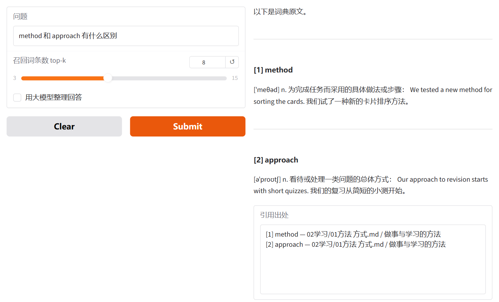
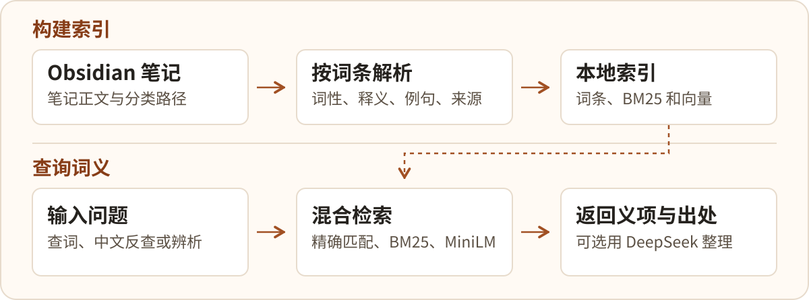

# 英语词义分类 RAG 知识库

一个在本机运行的英语学习工具。可以用中文找英文词，查单词和短语，也可以对照近义词在同一语境里的用法。每条结果附原始笔记路径。可选接入 DeepSeek，把找到的释义和例句整理成带引用的答案。

**词汇数据来源**　项目使用的《英语词义分类数据库（大学版）》由姜忠成（猛虎狂奔）编撰。[猛虎狂奔的哔哩哔哩主页](https://space.bilibili.com/1091814913)

## 语料数据

完整词库是一套按语义分类组织的 Obsidian 笔记库，实测规模如下：

| 项 | 数值 |
| --- | --- |
| 笔记文件 | 1,790 篇 Markdown |
| 正文规模 | 约 1,319 万字符 |
| 语义大类 | 53 个（基础领域、专业学科、心理情绪……），每类再按组与子主题细分 |
| 词条标记（vocabulary） | 58,952 个 |
| 释义标记（definition） | 37,356 个 |
| 子主题标记（category） | 2,708 个 |
| 双链（wikilink） | 10,032 条 |

上面的标记数是 HTML span 在全库中的出现次数：同一个词会出现在多个主题和复习清单里。解析时剔除只有词头、没有释义的目录页与复习清单页，再按词条切分，最终进入索引的是 **29,470 条词条记录，覆盖 9,681 个不同词头**。同一个词在不同主题下的义项保留为独立记录——这正是近义词辨析能「同组对照」的数据基础。

## 界面预览



用仓库自带的示例词库查询「method 和 approach 有什么区别」。左侧提交问题，右侧显示两词在同一语境下的释义、例句和笔记路径。

## 试试这些问题

| 想做什么 | 可以这样问 | 会看到什么 |
| --- | --- | --- |
| 查短语 | `black market 是什么意思` | 完整短语、中文释义和出处 |
| 中文反查 | `表示突然转弯的动词有哪些` | `swerve`、`veer` 等候选，按动词筛选 |
| 近义词辨析 | `method 和 approach 有什么区别` | 两者在「方法、方式」语境中的释义和搭配 |
| 按组学习 | `method 和 approach 有什么区别，这一组还有哪些` | 相关义项和同组词 |

以上问题可以直接用随仓库提供的自写小词库试跑。

## 在 Windows 上运行

在仓库目录打开 PowerShell。以下步骤使用 Python 3.12。

```powershell
python -m venv .venv
.\.venv\Scripts\python.exe -m pip install -r requirements.txt
if (-not (Test-Path -LiteralPath data\vault)) {
    New-Item -ItemType Directory -Path data -Force | Out-Null
    Copy-Item -LiteralPath examples\vault -Destination data\vault -Recurse
}
.\.venv\Scripts\python.exe parse_vault.py
.\.venv\Scripts\python.exe build_index.py
.\.venv\Scripts\python.exe app.py
```

打开 [本地网页](http://127.0.0.1:7860/)，输入上面的任意问题。首次建索引时会下载多语言 MiniLM。检索在本机完成，直接显示释义、例句和出处。

**使用完整词库**时，请从作者渠道获取原始 Obsidian 笔记，使主题目录直接位于 `data/vault/` 下，然后重新执行解析和索引构建命令。已有示例词库时，先移走 `data/vault/` 中的 `01出行`、`02学习`、`03商业` 三个示例目录。仓库提供项目代码和自写演示笔记，原作者词库与生成的索引由使用者在本地准备。使用词库请遵循原版随附的版权声明。

### 可选接入 DeepSeek

在项目根目录新建 `.env`，填入自己的密钥，重启网页后勾选「用大模型整理回答」。

```dotenv
DEEPSEEK_API_KEY=<redacted>
LLM_MODEL=deepseek-flash
```

勾选后，问题和召回的词条会发送给模型接口。接口失败或引用编号无效时，网页会显示词典原文。也可以通过 `LLM_API_KEY`、`LLM_BASE_URL` 和 `LLM_MODEL` 配置其他 OpenAI 兼容接口。

## 构建管线

这套笔记没有 Markdown 标题、没有 frontmatter，正文结构全靠 HTML span 标记，所以不能套用按固定长度切块的通用 RAG 流程。实际做法分四步：

1. **按词条解析切分**（`parse_vault.py`）。自写解析器扫描 span 标记：`vocabulary` 是词头、`definition` 是释义与例句、`category` 是子主题；以「一个词条 = 一个 chunk」切分，提取词头、词性、义项、例句四个字段。文件夹路径（大类 / 组 / 主题）直接存为元数据，兼作引用出处。
2. **向量化**（`build_index.py`）。用 fastembed 在本地以 ONNX 运行多语言模型 `paraphrase-multilingual-MiniLM-L12-v2`（384 维，中英双语），把「词头 + 词性 + 简短释义 + 主题」拼接后生成向量。构建时按文本长度排序分批、逐批落盘检查点，中断后可从检查点续跑；29,470 条向量全部在本机 CPU 完成。这个规模（约 3 万 × 384）用 numpy 余弦相似度矩阵乘法就够快，没有引入独立向量数据库。
3. **关键词索引**。同时用 jieba 分词为每条词条建 BM25 语料，词头在语料中加权重复，保证短语和专有词头的精确命中不被语义相似结果淹没。
4. **整体落盘**（`index_store.py`）。词条、向量、BM25 三部分一起保存、一起加载，索引整体更新，不做增量合并。

## 检索怎么做



1. **按词条入库。** 解析 Obsidian 笔记中的 HTML 标记，保留词性、义项、主题、例句和原始路径。用词头、词性、简短释义和主题生成向量。
2. **按问题找义项。** 查词优先匹配完整词头或短语，中文反查融合 BM25 和 MiniLM 向量分数，并按明确指定的词性筛选。辨析时优先召回两个词同一主题分组下的义项。
3. **按需生成。** 将召回条目编号交给 DeepSeek，检查返回的引用编号能否对应原词条。索引在本地构建并整体更新，词条、向量和 BM25 数据一起保存。

只靠向量或只靠关键词都会翻车：查词是专有名词式命中，向量容易被语义相近的词挤掉；反查没有现成关键词，BM25 又无从下手。所以最终方案是「向量 + BM25 融合」打底，再叠加词条规则（短语精确匹配、词性筛选、同组召回）纠偏。

## 评测

在完整词库上共索引 **29,470 条词条记录**，覆盖 **9,681 个不同词头**。同一套 18 条人工标注的回归题覆盖短语、词性、义项、辨析和查无此词。

| 检索方式 | 通过 |
| --- | ---: |
| 旧版混合检索 | 6/18 |
| 新版 BM25 + 词条规则 | 16/18 |
| 新版 MiniLM + 词条规则 | 14/18 |
| 新版混合检索 | 18/18 |

用完整词库建立索引后，可用 `python eval_retrieval.py --require-all` 复跑。这组结果用于回归检查，生成答案的引用内容按案例核对。

### 实测效果

- **回归题从 6/18 提升到 18/18**：主要增益不来自换模型，而是词条规则——短语精确匹配救回查词类问题，词性筛选过滤反查噪声，同组召回让辨析题的两个词落在同一语境里对比。
- **三类典型查询**：查短语 `black market 是什么意思` 直接命中完整短语条目；反查 `表示突然转弯的动词有哪些` 返回 `swerve`、`veer` 等同主题动词；辨析 `method 和 approach 有什么区别` 把两词在「方法、方式」主题下的义项并排召回。
- **全程本地**：解析、向量化、检索都在本机完成，不依赖任何在线服务；只有勾选大模型整理时，问题和召回词条才会发给模型接口。
- **可溯源、不编造**：每条结果附原始笔记路径；生成答案的引用编号逐条校验，对不上就回退显示词典原文。
